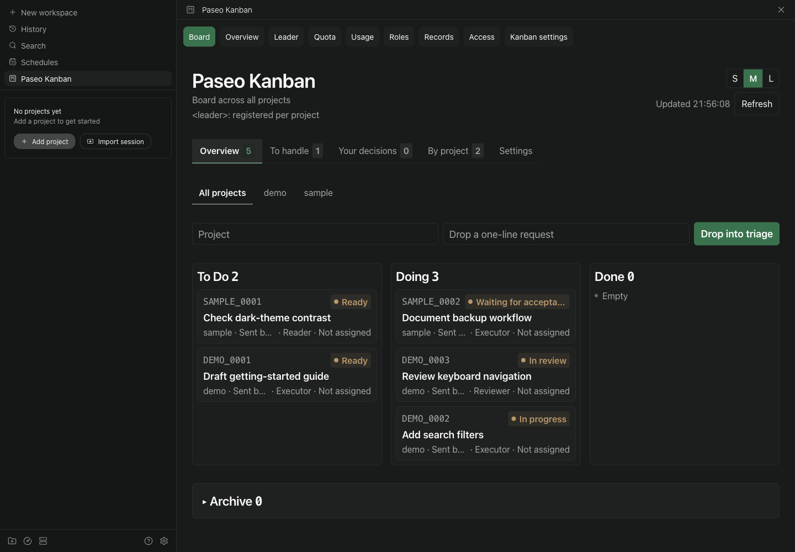
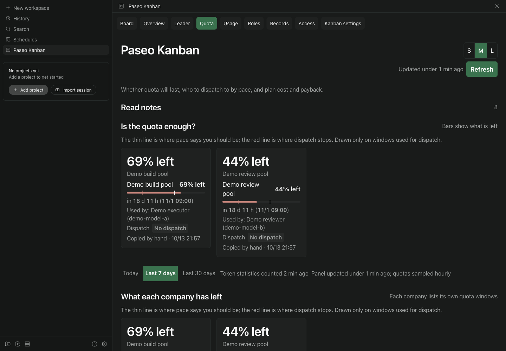

# Paseo Kanban

用于 [Paseo](https://github.com/getpaseo/paseo) 的单插件，把跨项目代码 agent 看板与 Fleet 阵容、额度、决定和设置放在一起。执行者交活，使用不同实际模型的审查者核对，最后由项目 leader 验收。

[English](../../README.md)

> **实验性 RC `0.1.0-rc.8`，尚未发布。** 已公开预发布 `0.1.0-rc.7` 于 2026-10-14 发布，GitHub Release 存在。只有对应 GitHub prerelease 存在，且目标为[发布记录](RELEASE.md)中的独立审查提交时，才能安装 rc.8 的 tag。已在 macOS 的 Microsoft Edge 验证隔离官方 **0.11.2 Web UI**；原生 app、真实手机及已认证 provider 首卡仍未验证。不宣布稳定版、npm 发布、官方目录收录或响应时间承诺。

唯一插件 id 为 `paseo-kanban`，一个侧栏入口打开看板、Fleet 和设置，看板使用包含宿主 id 的深链，并保留 workspace 项目筛选。

## 界面

以下是隔离官方 Paseo 0.11.2 宿主中，本机 Microsoft Edge 截取的实际插件页面。卡片、项目、档案和额度均为合成数据；图片证明 Web UI 挂载，不证明真实 provider 闭环或原生设备兼容。[截图说明](../MEDIA.md)。





卡片的临时内容现在使用项目下的 `.kanban-work/<卡号>/`；配置、回退与清理见[卡片工作目录](CARD-WORK-DIRECTORIES.md)。

## Paseo 0.11.2 的 Command Center 与图标

macOS 按 **⌘K**（Windows／Linux 为 Ctrl+K）搜索 **打开项目看板**；标题随插件的中英文语言设置更新。官方 **0.11.2 Web UI** 只在当前页面具有本安装的宿主上下文时显示该动作，例如已打开的插件页或活动工作区。没有宿主上下文的空首页**不显示**该动作；离开插件页回到空首页后也不会显示。先点侧栏 **Paseo Kanban** 打开看板。在 Settings 选择宿主，并不代表每个页面都有该上下文。见[兼容性](COMPATIBILITY.md#command-center-与-manifest-图标)。

`assets/icon.png` 是用于未来可能的 registry 展示的 manifest 元数据。官方 0.11.2 的 **Settings -> Plugins** 列表不显示 manifest 图标；它与侧栏／命令的 contribution 图标不同。不声明已获 registry 收录。见[媒体说明](../MEDIA.md)。

## 从这里开始

1. **准备：** Paseo daemon 和 app `>=0.11.0 <0.12.0`，Node `>=24.21.0` 且 `node:sqlite` 可用，另需 Git、npm。只在目标宿主启用受信任插件，先阅读下方访问说明。真实自动首卡需要自行登录的本地 provider／档案，且两个实际 model 已确认、非空、不同。见[前置要求](#前置要求)。
2. **安装：** 按[GitHub 安装](#从-github-安装)明确指定已公开基线。RC tag 要等对应 Release 存在才能用；评估未公开候选时，在隔离开发 daemon 按[本地 directory 流程](#开发者-directory-流程)操作。
3. **首次可见成功：** `paseo plugin ls paseo-kanban --json` 报告 `running` 且无加载错误；同一宿主侧栏的 **Paseo Kanban** 能打开看板与 Fleet。再按[首卡配置](#配置并完成首卡)核对 commit、独立审查和 leader 验收。截图不代表 provider 首卡已通过。

旧 RC 的提交、tag 身份和拒绝发布历史保留在[变更记录](CHANGELOG.md)与[发布记录](RELEASE.md)。

## 前置要求

- Paseo **daemon 和 app** 均在 `>=0.11.0 <0.12.0`，全局插件和本插件开关均启用。本批命令／编译器基线为 **0.11.2**；声明范围不代表每个补丁和客户端都已验证。
- Node **>=24.21.0** 且 `node:sqlite` 可用；Git、npm 位于 **daemon 宿主的 PATH**。包括 CLI 指向远端时，下载和准备都在该宿主执行。
- 用户自行安装、登录的本地 provider。自动执行／审查流程要求**两个已确认、非空、不同的实际 model**。发现 provider 不证明登录和额度可用。
- macOS arm64、Node 24.21.0/npm 12.1.0 有隔离本地 Git、CLI／编译和真实 0.11.2 Web app 证据，不认证其他版本或 provider 闭环。Linux、WSL2 仍需分别验证真实流程。首发不支持原生 Windows。见[兼容性](COMPATIBILITY.md)。

Paseo 插件是**受信任、无沙箱的代码**。server 和准备命令可以使用 daemon 用户的文件、进程、凭证和网络；client 运行在 app 内。本插件持久保存看板／Fleet 状态、操作配置的 workspace 和 agent，并可运行 Git、Node 与配置的 provider 命令。启用的额度适配器可能访问服务或调用本地工具。启用前阅读[访问及数据边界](DATA.md)。

## 从 GitHub 安装

先核对 CLI、daemon、app 版本及 daemon 的 Node 环境。`paseo --version` 只报告 CLI 版本，不证明 daemon/app 版本。**只有 `v0.1.0-rc.8` 的 GitHub Release 记录存在，且目标 commit 等于[发布记录](RELEASE.md)中的已审完整 SHA 时，才执行下面的 tag 命令。该记录不存在时，候选未发布，这个 tag 不是 GitHub 安装目标。**

```sh
paseo --version
node --version
paseo plugin install github:jasonhnd/paseo-kanban --ref v0.1.0-rc.8
paseo plugin ls paseo-kanban --json
```

这里使用官方 Paseo CLI 的 GitHub 下载路径。tag 绝不能挪动或复用；核对已安装完整 revision 与最终审过的 RC SHA，该 SHA 公开后也可作为 `--ref`。这些命令不表示插件已经通过官方目录审核。不要替换成裸 registry id `jasonhnd/paseo-kanban` 或 npm 来源。待发布期间，可以明确安装已公开的 **RC 前基线**：

```sh
paseo plugin install github:jasonhnd/paseo-kanban --ref c106efb88a659931d01f40a236001823473561a8 --json
```

该基线包元数据为 `0.1.0`。它不是 `0.1.0-rc.8`，也不是未公开的本地准备 `0.1.0-rc.1`。[RC 变更记录](CHANGELOG.md)列出源码变化与未解决的依赖告警。

1. 在目标宿主 **Settings -> Plugins** 打开 **Enable plugins** 和单独的 `paseo-kanban` 开关。全局开关也会启动其他单独启用的插件。全局开关开启后可运行 `paseo plugin enable paseo-kanban --json` 启用本插件。
2. 再运行 `paseo plugin ls paseo-kanban --json`，确认 `running` 且无加载错误。从该宿主的侧栏打开 **Paseo Kanban**；看板、Fleet、Settings 应共用这一个入口。必须打开真实页面；只有 `running` 不证明 client 挂载成功。窄视口不证明真实手机。
3. 只有 CLI 默认 daemon 正是目标时才用默认值。管理其他 daemon 时，每条命令均在 `plugin` 前加 `--host "$PASEO_TARGET"`，值为 `tcp://host:port` 等 CLI endpoint。非默认本地 home 另用 `--home`；与 `--host` 二选一，不能同用。[Git 安装](../GIT-INSTALL.md)详述宿主选择、版本确认和开发者 directory 安装。

在 **0.11.2 Web UI** 中，先从目标宿主侧栏打开 **Paseo Kanban**，再复制地址栏的完整 URL 保存书签。侧栏打开的地址为 `<web-origin>/h/<host-id>/plugin/paseo-kanban/surface/board?pluginId=paseo-kanban&contributionKind=surface&contributionId=board`。`<web-origin>` 是 Paseo Web UI 的源地址，`<host-id>` 是 Paseo 生成的宿主 id；两者均使用自己地址栏中的值。在同一已连接宿主中，不带查询参数的 `/h/<host-id>/plugin/paseo-kanban/surface/board` 和 `/h/<host-id>/plugin/paseo-kanban/sidebar/board` 也能打开看板。缺少宿主信息的短路径 `/plugin/paseo-kanban/board` 在这个宿主版本显示 **Unmatched Route**。这些验证仅适用于 0.11.2 Web UI，原生 app 链接仍未验证。

安装会按锁文件准备依赖并生成命令 bundle。使用者无需开发 checkout 或另跑 `npm run build`。相同 id 已安装时，重复 `install` 会失败；Git 来源使用[更新](#更新停用和卸载)，directory 来源使用[来源切换 runbook](RELEASE.md#directory-转-git-操作预案)。

## 配置并完成首卡

1. 在合并的 Settings 页选择英文或简体中文。Fleet 角色设置只**预览**可用档案；在 Paseo 手动配置适用档案并保留已有项。给 leader、executor、reviewer 设置 role、pool 和明确的实际 model。同 family 不同 model 允许；trim/lower 后相同 model 即使 provider、mode、effort 不同也拒绝。缺实际 model 证据时等待。预览不保存档案、不验证登录；用户自行登录 provider。
2. 配置自己的额度来源和策略。Fleet 向派活入口提供不可变 `paseo-policy/v1`；策略缺失／无效或受保护额度未知时，拒绝派活，未知不是 0。旧 `fleet-quota/v1` 文件、`afc`／`roles` 是同根下兼容入口。不要再注册独立的旧 Fleet 插件。
3. 新装使用 `KANBAN_DATA_DIR`，否则为 `PASEO_HOME/plugin-data/paseo-kanban`（Paseo home 默认 `~/.paseo`）。取消非空旧存储变量。不会自动导入旧资料；复用状态前阅读[数据归属](DATA.md)和[手动转移](../MANUAL-MIGRATION.md)。
4. 建立可丢弃的 `demo` Git 仓库／workspace，先做初始 commit。项目设置填 workspace、短号、保护分支；项目 leader 面板选档案／workspace／语言，预览并启动 leader，确认协议送达。普通对话选择同一档案不完成此设置。
5. 在该 leader 会话为 `demo` 调用 `kanban_supervise`，或运行：

   ```sh
   node "$BOARD_INSTALL/bin/paseo-kanban.mjs" supervise --project demo
   ```

   `BOARD_INSTALL` 取自 `paseo plugin ls paseo-kanban --json` 报告的当前安装路径。CLI 与插件使用相同 Paseo home／数据根。会话使用自己注入的身份，不粘贴 token。面板确认登记；已有活着的 leader 须交接，不直接替换。
6. 告诉 leader：“创建 L1 卡，在 demo 仓库添加 hello.md，内容严格为 Hello 加换行；检查文件与内容，本地提交、审查、验收，不 push 或发布。”核对执行 commit／交接、不同实际 model 审查、leader 验收、卡片完成、内容正确、Git 干净及托管 agent／workspace 清理。这是验证步骤，不是首卡已通过的报告。

派活等待时查[工作流](WORKFLOW.md)及[排错](COMPATIBILITY.md)。不要把认证文件、原始数据库、备份或未脱敏 doctor 输出发进 issue。

## 更新、停用和卸载

先备份状态，并记录当前完整 revision、来源、安装路径与 enabled 状态。确认 RC 已发布后，**每次明确 ref**，先预览再更新：

```sh
paseo plugin update paseo-kanban --check --ref v0.1.0-rc.8 --json
paseo plugin update paseo-kanban --ref v0.1.0-rc.8 --json
paseo plugin ls paseo-kanban --json
```

这两条更新命令同样只在 GitHub Release 记录允许 `v0.1.0-rc.8` 时使用，见[从 GitHub 安装](#从-github-安装)。托管更新后，看板和 Fleet 信息导出仍可能在约 600 秒内保留已删除 checkout 的路径，这是现有导出周期。新命令入口在动作执行时解析当前托管路径；导出延迟不变。

升级或 reload 期间，已挂载面板遇到暂时的“Plugin not available”读取失败会保留上次数据，并温和显示“插件正在更新…”。已确认可重复的读取最多退避重试 5 次，重试窗口不超过 15 秒；其他错误仍正常显示。保存和操作不会自动重试，请确认结果后再试。插件持续不可用时，面板会提示稍后刷新。

每次升级或代码回退后，保持停派活，直到同一宿主报告目标完整 revision、当前安装路径、enabled/running，且数据根和设置未变。更新 `BOARD_INSTALL`，从该路径运行已安装 Node CLI。等待两份导出都指向该路径，再在真实面板用获准的可丢弃决定：关闭，核两处计数和已存 done；在面板仍挂载时 Undo，再核恢复为 open。导出一致或只有 running 都不证明写入可用。动作失败时保留错误，继续停派活。

回退到 c106 或未改动的本地 rc.1/rc.2 代码时，**更新后必须在同一宿主运行 `paseo plugin reload paseo-kanban --json`，确认 running 再做上述复验**；这些旧版本在模块加载时缓存命令路径。reload 和所有 plugin 命令使用同一个 `--host` 或本地 `--home` 选择器，绝不同时用两者。GitHub 回退不可使用未公开 tag。reload 失败保持 failed，修复／重载前不恢复，不是自动回退。仅加载本代码改动无需重启 daemon。

`--check` 只预览。`--ref` 只选择这次操作；以后不带 ref 更新会跟随远端默认 HEAD。完整审过的 SHA 可精确指定目标。更新后核对 revision／路径和真实 UI，托管目录可能变化，因此更新 `BOARD_INSTALL`。不要在托管 checkout 里改代码或构建。[发布与恢复](RELEASE.md)提供备份、精确 SHA 回退和待重放清单。

要把代码回退到已验证的公开 c106 基线，保持同一数据根，两条操作都用完整 SHA：

```sh
paseo plugin update paseo-kanban --check --ref c106efb88a659931d01f40a236001823473561a8 --json
paseo plugin update paseo-kanban --ref c106efb88a659931d01f40a236001823473561a8 --json
paseo plugin reload paseo-kanban --json
paseo plugin ls paseo-kanban --json
```

```sh
paseo plugin disable paseo-kanban --json
paseo plugin enable paseo-kanban --json
paseo plugin remove paseo-kanban --json
```

停用会停止本插件；启用仍需全局开关。卸载会删除托管 Git checkout，并可能移除宿主插件设置；directory 源码保留。外置数据根独立，卸载不等于清空数据。0.11.2 新装会把单插件 enabled 设为 true，即使刚移除的来源为 disabled；全局开关已开时立即启动。切换前先防止派活，之后明确恢复所需 enabled 状态。重装保留同一 id／home／root，并明确恢复设置。**代码回退不恢复数据**；恢复一致备份是另一操作，会丢失备份后的写入。0.11.2 隔离实测的准备、语法编译、activation 失败保留旧托管 revision／path 与可用 RPC；每次失败仍须核对。`plugin reload` 失败保持 failed，须修复／重载，不自动恢复旧 bundle。

## 资料

[Git 安装](../GIT-INSTALL.md) · [工作流](WORKFLOW.md) · [数据与隐私](DATA.md) · [兼容性](COMPATIBILITY.md) · [发布](RELEASE.md) · [安全](SECURITY.md) · [变更](CHANGELOG.md)

## 开发者 directory 流程

本节用于改源码，与上面的使用者 GitHub 安装分开。从公开 integration 分支建立干净 clone、安装锁定依赖，并在用源码命令前构建：

```sh
git clone --branch integration/single-plugin-reviewed --single-branch https://github.com/jasonhnd/paseo-kanban.git
cd paseo-kanban
npm ci
npm run typecheck
npm run build
```

只在隔离开发 daemon 上用 `paseo plugin install "$PLUGIN_CHECKOUT"` 安装 directory，变量为 clone 的绝对路径。directory 直接引用 checkout，普通 Git update 会跳过；改源码并检查类型后用 `paseo plugin reload paseo-kanban`，无需重启 daemon。已有安装先准备来源切换方案再执行生命周期命令。

Git preparation 通过 manifest 的 `build` 运行 `server/prepare.mjs`。本地 `npm pack`／prepack／白名单检查验证分发字节，不发布到 npm。八个 Node bundle 为生成文件，不提交 Git。见[准备流程](../GIT-INSTALL.md#git-preparation-and-local-development)和[命令入口](../COMMAND-LAUNCHERS.md)；合并版本以本文 Node 要求为准。

可选 [Codex shell wrapper](../CODEX-WRAPPER.md)有独立配置和平台要求。[写入身份](../WRITE-PROVENANCE.md)只审认证身份，不证明 provider 回合来源。[工具链验证](../TOOLCHAIN-VALIDATION.md)与真实 app/provider 验收分开；[Antigravity 授权](../ANTIGRAVITY-AUTHORIZATION.md)记录该适配器派活边界。

## 开发者隐私闸

个人状态不能进入仓库或分发产物。这些检查适用于 Git 源码和本地打包产物；本批不走 npm 发布。

1. `.githooks/pre-commit` 扫描暂存文件的通用规则及仓外私人 denylist；身份检查只接受占位或 GitHub noreply；有 gitleaks 时同时运行。规则禁止私人 home 路径、邮箱、id、卡号、密钥、真实数据和中文对应目录以外的中文内容。
2. `npm run verify` 及 `.githooks/pre-push` 的十三闸包含类型、脚本／插件测试、CLI／真实 Paseo 编译、源码／完整可达历史／身份／泄漏、单源码契约及实质负例、真实包字节。出站 ref 与 annotated tag 单独扫描，并导出精确提交用锁定依赖重验。任何失败均拒绝发布；无需启用 GitHub Actions。
3. `package.json` 的 `files` 白名单由真实 `npm pack` 解包字节检查；它不是 npm 已发布证明。

```sh
npm ci
npm run hooks
git config user.name "paseo-fleet contributors"
git config user.email "<id>+<user>@users.noreply.github.com"  # 或 noreply@example.invalid
mkdir -p ~/.config/paseo-fleet
cp scripts/private-denylist.example.txt ~/.config/paseo-fleet/private-denylist.txt
brew install gitleaks
```

denylist 保留个人身份、项目和目录等禁止词，不进任何仓库；缺少它会拒绝本机提交。可用 `FLEET_PRIVATE_DENYLIST=<path>` 指定仓外路径。短词误报须改公开措辞，不削弱规则。

```sh
npm run verify
sh .githooks/pre-push </dev/null
npm run build:check  # 严格真实编译器；需要时 PASEO_SERVER_DIR 指公开宿主包
npm run typecheck
npm test
npm run test:plugin
npm run build
npm run scan
npm run identity
npm run pack:check
npm run contract:check
npm run shared:check
```

独立命令生成后以 Node 运行，tsx 等用于开发。测试保留 locale preload、私有临时目录、信号清理及回归完成后的性能阶段。单源码契约和闸命令负例不需要另一仓；旧比较工具保留为受测工具。[参与开发](CONTRIBUTING.md)

## 许可

[MIT](../../LICENSE)
